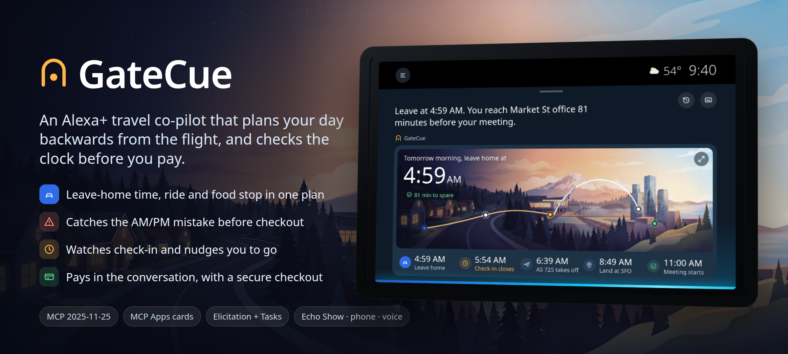

# GateCue



**An Alexa+ add-on that plans your travel day backwards from what matters, watches the clock for you, and checks AM from PM before you pay.**

Built for the Amazon Developer Hackathon 2026 (Alexa+ track). GateCue is a self-hosted MCP server with MCP Apps cards, plus an Alexa+ simulator to run it in.

## Why

The night before a work trip, the flight was at 6:39 AM. At the airport with time to spare, or so it seemed: check-in closed at 6:24 AM, and it was missed by two minutes. Rebooking in a panic at the gate, the "6:30" flight turned out to be 6:30 **PM**. Non-refundable. The meeting was gone too.

Every app involved was working as designed. None of them knew what the day was *for*. GateCue does:

- **Plans backwards from the goal.** "I need to be at an 11 AM meeting in San Francisco" becomes leave home 4:59 AM, be at check-in 5:39 AM, check-in closes 5:54 AM, with real drive time in traffic and your own buffer.
- **Watches the clock and speaks first.** In the food court at 5:32, Alexa says check-in closes in 22 minutes and it's a 6-minute walk. Leave now.
- **Is panic-proof when you rebook.** Ask for "the 6 o'clock" and GateCue shows you that it's 5:55 **PM**, this evening, and it lands after your meeting, before any money moves. Booking a flight that misses the goal needs an explicit "yes, I'll miss my meeting".

## What it does

| Tool | What it does | Card |
| --- | --- | --- |
| `get_trip_context` | What GateCue remembers: next trip, home, people, preferences (DynamoDB) | none |
| `plan_trip` | The day, backwards from the goal, with an Amazon Location drive time; the trip is remembered | Timeline over a painted panorama |
| `update_preferences` | Remembers "I like 20 minutes of buffer" for every future plan | none |
| `search_flights` | Today's remaining flights, marking which still make the goal; "the 6 o'clock" shows AM and PM side by side | Departure-board carousel |
| `review_flight` | The panic-proof check: day, AM/PM, "in 13 hours", makes the meeting or not, refund rule | Review card |
| `book_flight` | Pays through a secure checkout page (URL elicitation); a miss needs an explicit acknowledgement | Boarding pass |
| `book_ride` | Opens your ride app (Uber link) with home and the airport filled in, at the plan's leave time; you request or schedule and pay there | Ride card |
| `watch_trip` | A background Task that speaks first: when it's time to move, and when the flight is delayed, changes gate or is cancelled (spoken and emailed) | Live countdown ring, flight-update card |
| `get_flight_status` | Live status, gate and delays (AeroDataBox) | none |
| `email_trip_plan` | Emails the plan (Amazon SES); bookings are emailed automatically | none |

Every time GateCue says or shows carries AM or PM and the day. AM is tagged sunrise gold, PM dusk violet, in speech captions, cards and emails.

## Run it (no keys needed)

Requires Node 22.9+.

```bash
npm install
npm run build          # cards and simulator
npm run serve:demo     # MCP server at http://localhost:8787/mcp, demo clock set to 5:30 AM on Oct 15
```

Open **http://localhost:8787/sim/**, tap the mic (or type) and try:

1. "I need to be at an 11 AM meeting in San Francisco" (scene: *the night before*)
2. "Book the ride"
3. "Watch my check-in time" (scene: *at the airport*)
4. "My flight got cancelled", then "Just book the 6 o'clock"
5. While it's watching, use **Simulate → Flight change** in the header to delay, re-gate or cancel the flight

Alexa's replies are spoken with Amazon Polly when AWS is on, otherwise with the browser's voice (header: Voice on/off).

With `GC_BRAIN=bedrock` (and `aws login`), Amazon Nova on Bedrock understands free-form requests and picks the tools, so you can also try a new trip ("I need to be in Los Angeles by 2 PM tomorrow"), a preference ("I like 20 minutes of buffer") or something GateCue doesn't do ("book me a flight to Paris", which gets a clear answer about what's covered). Without a model, a scripted router plays the San Francisco story.

Without keys, GateCue uses a built-in illustrative flight schedule (made-up airlines, every pair of covered West Coast airports), a local test checkout page, estimated drive times and the browser's voice, and keeps memory in-process. Add keys to switch each part to the real service (see `.env.example`):

| Setting | Turns on |
| --- | --- |
| `RAPIDAPI_KEY` + `GATECUE_SCHEDULE=live` | Live schedules and flight status from AeroDataBox (`serve:demo` uses the demo schedule unless told otherwise) |
| `STRIPE_SECRET_KEY` (test mode only) | Real Stripe Checkout; the server refuses live keys |
| `GC_AWS=1` + `aws login` | DynamoDB memory, Amazon Location drive times, Amazon SES email, Amazon Polly voice |
| `UBER_CLIENT_ID` | Adds your Uber developer app ID to ride handoff links |
| `GC_TRAVELLER_EMAIL` | Where trip emails go (must be verified while SES is in sandbox) |
| `ANTHROPIC_API_KEY` or `GC_BRAIN=bedrock` | A real model drives the simulator instead of the scripted demo |

## How it fits together

```
 Alexa+ (or our simulator)                       GateCue MCP server (Node, Streamable HTTP, spec 2025-11-25)
 ┌──────────────────────────┐   tools/call      ┌──────────────────────────────────────────────────────────┐
 │ model picks tools        │ ───────────────▶  │ plan · search · review · book · watch · memory · email   │
 │ renders MCP Apps cards   │ ◀─ ui:// cards ── │ MCP Apps resources (sandboxed iframes, declared CSP)     │
 │ shows elicitation sheets │ ◀─ form / URL ─── │ form + URL elicitation, Tasks (watch_trip)              │
 └──────────────────────────┘                   └───────────────┬──────────────────────────────────────────┘
                                                                 │
              Amazon DynamoDB (memory) · Amazon Location Service (routes) · Amazon SES (email)
              Amazon Bedrock (Nova / Claude, simulator brain) · AeroDataBox (flights) · Stripe (test checkout)
```

- **`server/`** The MCP server. `plan.ts` is pure planning logic (unit-tested). `gatecue.ts` registers tools and cards. `memory.ts` (DynamoDB), `location.ts` (Amazon Location Routes v2), `mailer.ts` (SES v2) and `agent.ts` (Bedrock Converse or Anthropic Messages, switchable) each fall back gracefully when their service is off.
- **`views/`** The MCP Apps cards: plain TypeScript and CSS, bundled to single HTML files. Illustrations load from the server's `/assets`, declared in each card's `_meta.ui.csp.resourceDomains`.
- **`host/`** The Alexa+ simulator: an MCP host that renders cards through AppBridge in sandboxed iframes, handles elicitations and Tasks, and emulates Echo Show 8, Echo Show 15, phone and voice-only.
- **`design/`** Art direction, illustration masters and the motion language (`design/ART_DIRECTION.md`).

## AWS services

| Service | Used for | Code |
| --- | --- | --- |
| Amazon DynamoDB | Cross-session memory: traveller profile, saved places, preferences, trips (rebooking updates the trip) | `server/memory.ts` |
| Amazon Location Service | Traffic-aware drive time home → pickup stop → airport at the planned departure time | `server/location.ts` |
| Amazon SES | Plan and booking emails, with the same AM/PM tagging as the cards | `server/mailer.ts` |
| Amazon Polly | Alexa's voice in the simulator (generative "Ruth", neural fallback), cached per sentence | `server/voice.ts` |
| Amazon Bedrock | Converse API brain for the simulator (Nova 2 Lite by default; Claude on Bedrock via `GC_MODEL`) | `server/agent.ts` |

`npm run check:aws` and `npm run test:aws` verify each one against your logged-in account without printing credentials.

## Tests

```bash
npm test               # unit tests, end-to-end MCP test and 28 travel-day scenarios, against a fresh demo server
npm run test:agent     # the simulator driven by a model (a mock Anthropic API, no key needed)
npm run test:aws       # live DynamoDB, Location and Bedrock checks (needs aws login)
npm run test:email     # sends one real plan email through SES
```

The scenarios cover the hard cases: the night before, no flights left, "the 6 o'clock", stale quotes, declined and failed payments, preferences, rebooking memory, delays that do and don't break the plan, gate changes, cancellations, and a final check that every spoken time carries AM or PM. The end-to-end test negotiates protocol 2025-11-25, checks every tool's output schema and card resource, and runs the full story: plan, search, the PM trap, both elicitation types, checkout with its completion notification, and the `watch_trip` Task.

## Guardrails around the model

The model chooses tools, but the host enforces the rules that protect the traveller, each with a test:

- Actions (opening the ride app, paying for a flight, emailing, watching, changing preferences) run only when the latest request asks for them, or says yes to an offer.
- A flight can be paid for only after its review card was shown in an earlier turn.
- A time without AM or PM ("the 6 o'clock") always triggers a search around it first, so morning and evening are side by side before anything is booked.
- The ride always goes to the departure airport.
- Only the reply is spoken: any reasoning text a model emits is removed, and restating a card that already spoke is dropped.

## Pinned versions

- `@modelcontextprotocol/sdk` 1.30 (protocol 2025-11-25). The v2 packages target 2026-07-28, which Alexa+ doesn't speak.
- `@modelcontextprotocol/ext-apps` 1.7.5 (2.0 requires the v2 SDK). See `FRICTION_LOG.md`.

## Honest about what's simulated

- Fares and refund rules are simulated (there is no public fare API); every option says `fareSource: "simulated"`.
- Rides are handed off, not booked: ride companies keep booking APIs for partners, so GateCue opens the ride app prefilled and you request and pay there. Payments for flights are Stripe **test mode** only.
- The keyless demo schedule is illustrative, with made-up airlines (Cascade Air, Bayline, Northstar Airways). With `RAPIDAPI_KEY` and `GATECUE_SCHEDULE=live`, schedules and status are live.
- Coverage: flights between West Coast airports (Seattle, Portland, Spokane, the Bay Area, Sacramento, Reno, Los Angeles, Orange County, San Diego, Palm Springs, Las Vegas). They share Pacific time, so every time on a card, in speech and in email is right. Other time zones, including international trips, are the next step; until then GateCue says so instead of guessing.

## Credits and license

Code: Apache License 2.0 (`LICENSE`). Illustrations and loops were generated for this project (see `assets/CREDITS.md`) and are not covered by the code license. Font: Noto Sans (SIL OFL). Flight data by [AeroDataBox](https://aerodatabox.com/).
